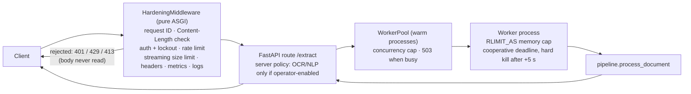
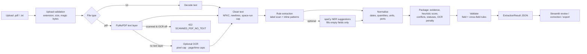

# Architecture

## Request path (API)

Auth, lockout, rate limiting and the size limit run **before the multipart body is read**, because FastAPI
parses the upload before any route code or dependency executes. A worker that times out is **killed and
replaced**; one that crashes (e.g. a native-parser fault) costs only that job; one that died while idle is
replaced and the job is retried (never after the job was sent). `SHIPINTEL_ISOLATION=inline` runs the job in the
request thread (tests/dev only).

## Extraction pipeline

`app/pipeline.py` has no UI or HTTP imports; FastAPI and Streamlit are thin layers over it. The rules live in a
package: `rules/labels.py` (alias dictionaries + label scanner), `rules/values.py` (value → typed candidates),
`rules/inline.py` (prose patterns).

## Key design decisions

| Decision | Reason |
|---|---|
| **Rules first, models optional** | Deterministic, explainable, instant, no training data. Brittle on unseen layouts (measured: 77.2% F1 on first unseen-template run vs 99.6% on tuned dev). |
| **Evidence on every value** | Page, offsets into the *cleaned* page text, snippet, label, method. Invariant (tested over all samples): the best candidate's evidence span contains `raw_value` verbatim. |
| **Null over guessing** | Missing, placeholder (`TBA`), ambiguous (`03/04/2025`), invalid (`31 February`), **ranged** (`12-15 March`, `45,000-50,000 MT`), multiple-valued and negative values become `null` + status + warning. A label-derived ambiguity outranks any inline guess. |
| **Linear-time patterns** | Every optional part of a regex starts with a distinct literal; a test sweeps every compiled pattern against pathological inputs. Defence in depth: whitespace-run cap, fuzzy-lookup memo and budget, cooperative deadline, hard process kill. |
| **Process isolation for the API** | `re` holds the GIL and native parsers cannot be interrupted from threads. Warm workers keep the overhead at ~1.5 ms per job. |
| **Server owns policy** | OCR/NLP are operator settings; clients can only turn features off. |
| **OCR bounded by pixels, not declared size** | A 520-byte PDF can declare a 200-inch page. DPI is reduced to a pixel cap; pages needing <100 DPI are refused. Grayscale render, no PNG round trip. |
| **OCR evidence is scored lower** | Measured: OCR lowers F1 by ~13 points even on clean renderings. Values are untouched; score −0.15 and an `OCR_TEXT` note. |
| **Heuristic score, not probability** | Label 0.90, next-line 0.85, fuzzy −0.15, inline 0.65, ± gazetteer hit/miss, +0.05 corroboration, −0.15 OCR. Below 0.60 → `needs_review`. Never presented as calibrated. |
| **Precision-leaning inline patterns** | Prose ports must hit the gazetteer. Costs recall on unknown ports in prose (documented limitation; the main spaCy opportunity). |
| **In-memory processing** | PDFs opened from bytes; no temp files created by the app (tested). |
| **Counterparty rule** | Charterer > shipper > consignee > buyer; other parties → info warning; owner/carrier is not a counterparty. |

## Statuses

`extracted` (copied, whitespace/case cleanup only) · `normalized` (date→ISO, number, unit, canonical port) ·
`missing` · `invalid` (evidence found, failed validation, value null) · `needs_review` (ambiguous, conflicting,
placeholder, unparseable, range, or score < 0.60) · `human_corrected` (edited in the UI; validated by the strict
`ExtractedRecord` model first). Document status is `needs_review` if any field is `needs_review`/`invalid` or nothing
was found.

## Validation rules and documented assumptions

Field level: real calendar date, year 1990–2100, quantity > 0 and ≤ 5,000,000, recognised unit (`MT, kg, bbl, TEU, m3`;
`tons` → MT *with* an ambiguity warning), quantity without a unit flagged. Cross field: `DISCHARGE_BEFORE_LOADING`,
`SAME_PORT`. Values are never altered by validation, only flagged.

Assumptions (also in `normalizers.py`): text-month and ISO dates are unambiguous; dotted numeric dates are day-first;
slash/dash numeric dates with both parts ≤ 12 are ambiguous → `null`; two-digit years are not interpreted;
**`1,234` is read as 1234 (comma = thousands)** while `1.234` is flagged ambiguous; a minus sign directly before a number
(preceded by whitespace/start) is a sign, a hyphen glued to a word is a separator; a human correction of unrelated fields
is never blocked by a *pre-existing* date-order warning, but editing a date into a wrong order is rejected.

## Extraction details

1. **Label scan** — `Label: value`, aligned `LABEL   value`, `a: x | b: y`, value on the next line (PDF tables). List
   markers (`1.`, `(a)`, `-`) are ignored. Exact alias match, then fuzzy (difflib ≥ 0.85, labels ≥ 7 chars) with a
   per-document budget, flagged `LABEL_FUZZY_MATCH`.
2. **Inline patterns** — `M/V NAME`, `loading at X`, `discharging at Y`, `from X to Y`, `lift … at X`, `chartered by …`,
   `carrying 45,000 MT of coal`, `reference is …`, and dates whose preceding words mention loading/discharge. Names do
   not cross line breaks except a plain text wrap (never into a `Label:` line).
3. **Selection** — per field: label-derived ambiguity first, then valid over null, role/score; agreeing candidates add
   evidence (+0.05); different values within 0.15 → `CONFLICTING_VALUES`.

## Security-relevant behaviour

See [operations.md](operations.md), [audit_remediation.md](audit_remediation.md) and
[security_review_checklist.md](security_review_checklist.md).
